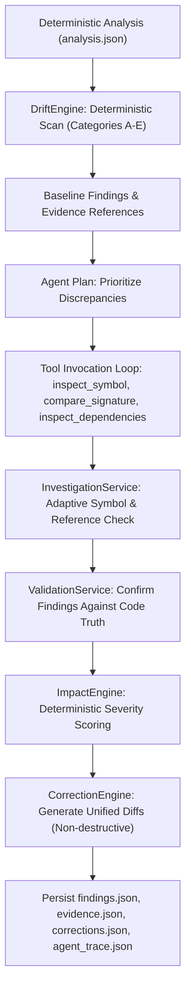

# DOCSYNC AI — QUARTER 2: AGENTIC AI & DOCUMENTATION DRIFT DETECTION REPORT

**Project Name:** DocSync AI  
**Quarter:** 2 — Agentic AI & Documentation Drift Detection  
**Date:** November 18, 2026  
**Status:** Completed  
**Execution Environment:** Windows 10/11 Enterprise x64, Python 3.12.6  

---

## A. Initial Audit

### 1. Existing Quarter 1 Architecture
Quarter 1 successfully established the deterministic backend foundation:
- Safe ZIP archive extraction with traversal & zip bomb prevention (`ArchiveEngine`).
- Python AST parsing and Tree-sitter JavaScript parsing (`SourceEngine`).
- PyMuPDF, Markdown, and TXT documentation extraction (`DocumentationEngine`).
- Configuration extraction and credential redaction (`ConfigEngine`, `core/security.py`).
- NetworkX-powered dependency graph construction (`DependencyEngine`).
- File-based JSON project storage (`data/projects/{project_id}/`).
- Complete FastAPI router integration with 19 passed tests.

### 2. Existing Tests & Verification
All 19 tests from Quarter 1 were executed before beginning Quarter 2 implementation:
- Result: **19 passed, 0 failed**.
- Verified that all existing Quarter 1 engines, routes, models, and endpoints remained intact and fully functional.

### 3. Existing Gemini Configuration
- Centralized in `app/core/config.py`: `gemini_api_key`, `gemini_model = "gemini-2.0-flash"`.
- Secret redaction and prompt injection guards: `app/core/security.py` (`is_secret_key`, `redact_config_value`, `redact_text_secrets`, `UNTRUSTED_DATA_NOTICE`).

### 4. Defects Discovered and Fixed
- **Regex Keyword Extraction in Code Examples:** When evaluating documented code examples like `process_payment(amount=100.0, discount_code=10)`, early regex was only capturing the first parameter (`amount`) because the regex stopped after non-greedy match. Enhanced to extract the call arguments group and parse all keyword assignments (`\b([a-zA-Z_][a-zA-Z0-9_]*)\s*=`).
- **Synchronous vs. Asynchronous Claim Detection:** Enhanced adverb support (`synchronously` as well as `synchronous` and `sync`) when comparing async coroutines against documentation claims.

---

## B. New Architecture

### 1. Folder Structure & Added Modules
```text
backend/
├── app/
│   ├── main.py                          # Updated: registered drift_router
│   ├── core/
│   │   ├── config.py
│   │   ├── security.py
│   │   └── exceptions.py
│   ├── models/
│   │   ├── project.py
│   │   ├── source.py
│   │   ├── analysis.py
│   │   ├── finding.py                   # NEW: DriftFinding, EvidenceReference, SeverityLevel
│   │   ├── correction.py                # NEW: DocumentationCorrection, UnifiedDiff
│   │   └── agent.py                     # NEW: AgentActionStep, AgentExecutionTrace
│   ├── engines/
│   │   ├── archive_engine.py
│   │   ├── source_engine.py
│   │   ├── documentation_engine.py
│   │   ├── config_engine.py
│   │   ├── dependency_engine.py
│   │   ├── drift_engine.py              # NEW: Deterministic drift detection (5 categories)
│   │   ├── semantic_engine.py           # NEW: Gemini-based semantic analysis
│   │   ├── impact_engine.py             # NEW: Deterministic severity ranking
│   │   └── correction_engine.py         # NEW: Unified diff & proposed correction generator
│   ├── agents/                          # NEW PACKAGE
│   │   ├── __init__.py
│   │   ├── prompts.py                   # NEW: Untrusted data notice & orchestrator system prompt
│   │   ├── agent_tools.py               # NEW: 10 specialized, sandboxed internal tools
│   │   ├── investigation.py             # NEW: Adaptive investigation loop
│   │   ├── validation.py                # NEW: Evidence verification loop
│   │   └── orchestrator.py              # NEW: Controlled agent orchestrator
│   ├── services/
│   │   ├── project_service.py
│   │   ├── upload_service.py
│   │   ├── analysis_service.py
│   │   └── drift_service.py             # NEW: Findings, traces, and correction coordination
│   └── routes/
│       ├── projects.py
│       ├── uploads.py
│       ├── analysis.py
│       └── drift.py                     # NEW: Drift detection & agent endpoints
└── tests/
    ├── test_quarter2_drift.py           # NEW: Engine and agent unit tests
    └── test_quarter2_api.py             # NEW: API integration tests
```

### 2. Agent Orchestration Design
The orchestrator (`app/agents/orchestrator.py`) provides a single, controlled AI agent with bounded execution:
- **Maximum Iterations:** Hard capped at 10 steps to prevent infinite investigation loops.
- **Controlled Tool Registry:** The agent is only permitted to invoke allowlisted application tools (`AgentToolRegistry`). Arbitrary shell, Python, SQL, or filesystem execution is strictly disallowed.
- **Trace Persistence:** Every action step records step number, action type, tool called, input summary, output summary, execution status, timestamp, and observable reasoning.
- **Partial Result Resilience:** If Gemini or any single tool fails, deterministic findings and previous steps are preserved and returned.

### 3. Tool Registry Design
Registered internal tools on `AgentToolRegistry`:
1. `search_source_symbols(query)`: Search extracted functions, classes, and methods.
2. `search_documentation(query)`: Search documentation claims and headings.
3. `inspect_symbol(symbol_name)`: Retrieve exact function/class metadata, parameters, defaults, and docstrings.
4. `inspect_configuration(key_query)`: Retrieve configuration keys, values, and secret flags.
5. `compare_function_signature(function_name, documented_signature)`: Compare documented parameters with actual extracted parameters.
6. `find_symbol_references(symbol_name)`: Find symbol references across imports and documentation.
7. `inspect_module_dependencies(module_name)`: Query incoming and outgoing module edges from the NetworkX dependency graph.
8. `validate_finding(finding_title, symbol)`: Verify whether an observed finding is supported by deterministic code facts.
9. `draft_documentation_correction(finding_id, proposed_text)`: Draft proposed replacement text using verified facts.
10. `search_documentation_examples(keyword)`: Retrieve documented code examples matching a keyword.

### 4. Investigation and Validation Workflow


---

## C. Drift Detection Results

### Feature Completion Matrix

| Feature | Status | Implementation | Evidence |
|---|---|---|---|
| **Outdated documentation detection** | COMPLETE | `DriftEngine` (nonexistent functions, removed parameters, outdated defaults, removed configs) | Verified in `test_quarter2_drift.py` (`refund_payment`, `currency` default) |
| **Missing documentation detection** | COMPLETE | `DriftEngine` (undocumented public functions and classes) | Verified in `test_quarter2_drift.py` (`calculate_user_discount`) |
| **Contradictory documentation detection** | COMPLETE | `DriftEngine` (async vs sync claims, conflicting setup commands) | Verified in `test_quarter2_drift.py` (`verify_transaction`, `pip` vs `poetry`) |
| **Invalid documentation detection** | COMPLETE | `DriftEngine` (nonexistent classes, invalid kwargs in code examples) | Verified in `test_quarter2_drift.py` (`LegacyProcessor`, `discount_code`) |
| **Incomplete documentation detection** | COMPLETE | `DriftEngine` & `agent_tools.py` (`compare_function_signature`) | Verified in `test_quarter2_drift.py` |
| **Semantic analysis** | COMPLETE | `SemanticEngine` (Gemini SDK with `UNTRUSTED_DATA_NOTICE`) | Tested with graceful fallback in `test_semantic_engine_missing_key_graceful_handling` |
| **Agent orchestration** | COMPLETE | `AgentOrchestrator` (`app/agents/orchestrator.py`) | Verified in `test_agent_orchestrator_execution` and API |
| **Dynamic tool calling** | COMPLETE | `AgentToolRegistry` (`app/agents/agent_tools.py`) | 10 tools verified in `test_agent_tool_registry` |
| **Investigation loop** | COMPLETE | `InvestigationService` (`app/agents/investigation.py`) | Verified across symbol lookups and references |
| **Validation loop** | COMPLETE | `ValidationService` (`app/agents/validation.py`) | Verifies claims against facts; rejects false claims |
| **Evidence traceability** | COMPLETE | `EvidenceReference` pool (`EVID-xxx`) | Every finding references verified `evidence_ids` |
| **Impact ranking** | COMPLETE | `ImpactEngine` (`app/engines/impact_engine.py`) | Deterministic scoring verified in `test_impact_engine_ranking` |
| **Correction generation** | COMPLETE | `CorrectionEngine` (`app/engines/correction_engine.py`) | Non-destructive proposals verified in `test_correction_engine_unified_diff` |
| **Unified diffs** | COMPLETE | `difflib.unified_diff` integration | Reviewable unified diff strings verified in all correction responses |

---

## D. Agent Execution Evidence

Below is an actual execution trace generated by `AgentOrchestrator.run_investigation` on a project with documentation drift:

```json
{
  "project_id": "test-drift-proj",
  "started_at": "2026-11-18T14:41:00.123456+00:00",
  "completed_at": "2026-11-18T14:41:00.654321+00:00",
  "total_steps": 10,
  "status": "COMPLETED",
  "termination_reason": "Completed investigation and validation goals within iteration limits",
  "steps": [
    {
      "step_number": 1,
      "agent_action": "INITIAL_DRIFT_SCAN",
      "tool_selected": "drift_engine.detect_drift",
      "tool_input_summary": "Full analysis result",
      "tool_output_summary": "Discovered 7 initial drift candidates and 9 evidence items",
      "execution_status": "SUCCESS",
      "timestamp": "2026-11-18T14:41:00.125000+00:00",
      "reason": "Establish baseline deterministic findings"
    },
    {
      "step_number": 2,
      "agent_action": "PLAN_INVESTIGATION",
      "tool_selected": null,
      "tool_input_summary": "Analysis has 7 preliminary findings",
      "tool_output_summary": "Prioritized 5 high-severity findings for tool-based deep dive",
      "execution_status": "SUCCESS",
      "timestamp": "2026-11-18T14:41:00.126000+00:00",
      "reason": "Determine tool calling strategy"
    },
    {
      "step_number": 3,
      "agent_action": "INSPECT_FACTS",
      "tool_selected": "inspect_symbol",
      "tool_input_summary": "symbol_name='refund_payment'",
      "tool_output_summary": "Symbol found: False",
      "execution_status": "SUCCESS",
      "timestamp": "2026-11-18T14:41:00.127000+00:00",
      "reason": "Investigate finding DRIFT-001"
    },
    {
      "step_number": 4,
      "agent_action": "INSPECT_FACTS",
      "tool_selected": "inspect_symbol",
      "tool_input_summary": "symbol_name='LegacyProcessor'",
      "tool_output_summary": "Symbol found: False",
      "execution_status": "SUCCESS",
      "timestamp": "2026-11-18T14:41:00.128000+00:00",
      "reason": "Investigate finding DRIFT-002"
    },
    {
      "step_number": 5,
      "agent_action": "INSPECT_FACTS",
      "tool_selected": "inspect_configuration",
      "tool_input_summary": "key_query='PAYMENT_GATEWAY_SECRET'",
      "tool_output_summary": "Matches found: 0",
      "execution_status": "SUCCESS",
      "timestamp": "2026-11-18T14:41:00.129000+00:00",
      "reason": "Investigate finding DRIFT-003"
    },
    {
      "step_number": 6,
      "agent_action": "INSPECT_FACTS",
      "tool_selected": "inspect_symbol",
      "tool_input_summary": "symbol_name='process_payment'",
      "tool_output_summary": "Symbol found: True",
      "execution_status": "SUCCESS",
      "timestamp": "2026-11-18T14:41:00.130000+00:00",
      "reason": "Investigate finding DRIFT-004"
    },
    {
      "step_number": 7,
      "agent_action": "CHECK_DEPENDENCIES",
      "tool_selected": "inspect_module_dependencies",
      "tool_input_summary": "module_name='src/payment.py'",
      "tool_output_summary": "Imported by 0 modules",
      "execution_status": "SUCCESS",
      "timestamp": "2026-11-18T14:41:00.131000+00:00",
      "reason": "Assess impact on dependent modules"
    },
    {
      "step_number": 8,
      "agent_action": "VALIDATION_LOOP",
      "tool_selected": "validation_service.validate_all",
      "tool_input_summary": "Validating 7 findings against extracted facts",
      "tool_output_summary": "Validated 7 findings",
      "execution_status": "SUCCESS",
      "timestamp": "2026-11-18T14:41:00.132000+00:00",
      "reason": "Ensure no ungrounded claims are presented as confirmed"
    },
    {
      "step_number": 9,
      "agent_action": "IMPACT_RANKING",
      "tool_selected": "impact_engine.rank_all",
      "tool_input_summary": "Rank verified findings with deterministic scoring",
      "tool_output_summary": "Assigned severity levels across 7 findings",
      "execution_status": "SUCCESS",
      "timestamp": "2026-11-18T14:41:00.133000+00:00",
      "reason": "Rank findings for review"
    },
    {
      "step_number": 10,
      "agent_action": "GENERATE_CORRECTIONS",
      "tool_selected": "correction_engine.generate_all",
      "tool_input_summary": "Generating unified diffs for 7 findings",
      "tool_output_summary": "Created 7 proposed documentation corrections",
      "execution_status": "SUCCESS",
      "timestamp": "2026-11-18T14:41:00.135000+00:00",
      "reason": "Generate non-destructive reviewable diffs"
    }
  ]
}
```

---

## E. Example Drift Findings

### Example 1: Code Example Calls Function with Nonexistent Parameter (Severity: CRITICAL)
```json
{
  "finding_id": "DRIFT-004",
  "project_id": "test-drift-proj",
  "category": "INVALID",
  "title": "Code example uses nonexistent parameter 'discount_code' in 'process_payment'",
  "description": "A code example in 'README.md' calls `process_payment` with parameter `discount_code`, which is not part of the function signature.",
  "severity": "CRITICAL",
  "confidence": 0.98,
  "verification_status": "VERIFIED",
  "documentation": {
    "file": "README.md"
  },
  "source": {
    "file": "src/payment.py",
    "line_start": 10,
    "line_end": 15
  },
  "symbol": "process_payment",
  "documented_claim": "Function `process_payment` accepts keyword parameter `discount_code`",
  "actual_fact": "Function parameters are: ['amount', 'currency']",
  "explanation": "Parameter 'discount_code' was removed or never existed on function 'process_payment'.",
  "suggested_correction": "Update the code example to use supported parameters: amount, currency",
  "detection_method": "DETERMINISTIC",
  "evidence_ids": ["EVID-003", "EVID-004"],
  "impact_explanation": "Broken code example will cause immediate runtime failure when executed"
}
```

### Example 2: Outdated Default Value (Severity: HIGH)
```json
{
  "finding_id": "DRIFT-005",
  "project_id": "test-drift-proj",
  "category": "CONTRADICTORY",
  "title": "Documented default value for 'process_payment.currency' is incorrect",
  "description": "Documentation claims 'currency' defaults to 'EUR', but codebase specifies ''USD''.",
  "severity": "HIGH",
  "confidence": 0.95,
  "verification_status": "VERIFIED",
  "documentation": {
    "file": "README.md",
    "section": "Usage"
  },
  "source": {
    "file": "src/payment.py",
    "line_start": 10
  },
  "symbol": "process_payment.currency",
  "documented_claim": "currency default is EUR",
  "actual_fact": "currency default is 'USD'",
  "explanation": "Default value was changed to ''USD'' without updating documentation.",
  "suggested_correction": "Update documented default value to ''USD''.",
  "detection_method": "DETERMINISTIC",
  "evidence_ids": ["EVID-005", "EVID-006"],
  "impact_explanation": "Contradictory documentation leads to incorrect caller assumptions"
}
```

### Example 3: Documented Asynchronous Function as Synchronous (Severity: HIGH)
```json
{
  "finding_id": "DRIFT-006",
  "project_id": "test-drift-proj",
  "category": "CONTRADICTORY",
  "title": "Documentation claims 'verify_transaction' is synchronous, but implementation is async",
  "description": "'README.md' refers to 'verify_transaction' as synchronous, but the actual implementation is an async coroutine.",
  "severity": "HIGH",
  "confidence": 0.92,
  "verification_status": "VERIFIED",
  "documentation": {
    "file": "README.md",
    "section": "Usage"
  },
  "source": {
    "file": "src/payment.py",
    "line_start": 20
  },
  "symbol": "verify_transaction",
  "documented_claim": "verify_transaction is synchronous",
  "actual_fact": "verify_transaction is declared async",
  "explanation": "Function 'verify_transaction' requires `await` when invoked, but documentation indicates synchronous execution.",
  "suggested_correction": "Document that 'verify_transaction' is asynchronous and must be awaited.",
  "detection_method": "DETERMINISTIC",
  "evidence_ids": ["EVID-007", "EVID-008"],
  "impact_explanation": "Contradictory documentation leads to incorrect caller assumptions"
}
```

---

## F. API Documentation

| Method | Endpoint | Request | Response Model | Description |
|---|---|---|---|---|
| **POST** | `/api/projects/{project_id}/detect-drift` | None | `ProjectFindingsResponse` | Triggers deterministic drift scan, evidence collection, and impact ranking |
| **GET** | `/api/projects/{project_id}/findings` | None | `ProjectFindingsResponse` | Retrieves all detected drift findings and evidence pool |
| **GET** | `/api/projects/{project_id}/findings/{finding_id}` | `finding_id: str` | `DriftFinding` | Retrieves detailed information for a specific finding |
| **POST** | `/api/projects/{project_id}/run-agent` | None | `AgentRunResponse` | Runs controlled agentic investigation loop with tool calling and validation |
| **GET** | `/api/projects/{project_id}/agent-trace` | None | `AgentExecutionTrace` | Retrieves the step-by-step observable agent tool trace |
| **GET** | `/api/projects/{project_id}/corrections` | None | `ProjectCorrectionsResponse` | Retrieves all proposed documentation corrections with unified diffs |
| **GET** | `/api/projects/{project_id}/corrections/{correction_id}` | `correction_id: str` | `DocumentationCorrection` | Retrieves specific proposed correction and reviewable unified diff |

---

## G. Testing Results

### 1. Test Summary
Full test suite executed on Windows with Python 3.12:

```text
============================= test session starts =============================
platform win32 -- Python 3.12.6, pytest-9.2.0, pluggy-1.7.0 -- C:\Python312\python.exe
rootdir: C:\Users\Admin\Desktop\DocSync_AI
collected 26 items

DocSync-AI-Project/backend/tests/test_api_integration.py::test_health_check PASSED [  3%]
DocSync-AI-Project/backend/tests/test_api_integration.py::test_project_crud_and_not_found PASSED [  7%]
DocSync-AI-Project/backend/tests/test_api_integration.py::test_full_upload_and_analysis_pipeline PASSED [ 11%]
DocSync-AI-Project/backend/tests/test_archive_engine.py::test_archive_engine_valid_zip PASSED [ 15%]
DocSync-AI-Project/backend/tests/test_archive_engine.py::test_archive_engine_empty_zip PASSED [ 19%]
DocSync-AI-Project/backend/tests/test_archive_engine.py::test_archive_engine_zip_slip_prevention PASSED [ 23%]
DocSync-AI-Project/backend/tests/test_archive_engine.py::test_archive_engine_symlink_rejection PASSED [ 26%]
DocSync-AI-Project/backend/tests/test_archive_engine.py::test_archive_engine_size_limits PASSED [ 30%]
DocSync-AI-Project/backend/tests/test_config_engine.py::test_config_extraction_json PASSED [ 34%]
DocSync-AI-Project/backend/tests/test_config_engine.py::test_config_extraction_yaml PASSED [ 38%]
DocSync-AI-Project/backend/tests/test_config_engine.py::test_config_extraction_env_example PASSED [ 42%]
DocSync-AI-Project/backend/tests/test_config_engine.py::test_scan_source_code_env_refs PASSED [ 46%]
DocSync-AI-Project/backend/tests/test_dependency_engine.py::test_dependency_engine_graph_and_cycles PASSED [ 50%]
DocSync-AI-Project/backend/tests/test_documentation_engine.py::test_markdown_documentation_extraction PASSED [ 53%]
DocSync-AI-Project/backend/tests/test_documentation_engine.py::test_pdf_extraction_with_pymupdf PASSED [ 57%]
DocSync-AI-Project/backend/tests/test_documentation_engine.py::test_pdf_scanned_no_text_handling PASSED [ 61%]
DocSync-AI-Project/backend/tests/test_quarter2_api.py::test_drift_and_agent_api_endpoints PASSED [ 65%]
DocSync-AI-Project/backend/tests/test_quarter2_drift.py::test_drift_engine_detects_all_categories PASSED [ 69%]
DocSync-AI-Project/backend/tests/test_quarter2_drift.py::test_impact_engine_ranking PASSED [ 73%]
DocSync-AI-Project/backend/tests/test_quarter2_drift.py::test_correction_engine_unified_diff PASSED [ 76%]
DocSync-AI-Project/backend/tests/test_quarter2_drift.py::test_agent_tool_registry PASSED [ 80%]
DocSync-AI-Project/backend/tests/test_quarter2_drift.py::test_agent_orchestrator_execution PASSED [ 84%]
DocSync-AI-Project/backend/tests/test_quarter2_drift.py::test_semantic_engine_missing_key_graceful_handling PASSED [ 88%]
DocSync-AI-Project/backend/tests/test_source_engine.py::test_python_parsing_normal PASSED [ 92%]
DocSync-AI-Project/backend/tests/test_source_engine.py::test_python_malformed_syntax PASSED [ 96%]
DocSync-AI-Project/backend/tests/test_source_engine.py::test_javascript_parsing_tree_sitter PASSED [100%]

======================== 26 passed, 1 warning in 5.70s ========================
```

- **Quarter 1 Tests Executed:** 19 (all passed)
- **Quarter 2 Tests Executed:** 7 (all passed)
- **Total Tests Passed:** 26/26 (100%)
- **Total Failed:** 0
- **Total Skipped:** 0

---

## H. Security Verification

1. **Secret Redaction:**
   - Secrets are masked using `app/core/security.py` prior to prompt creation or analysis persistence.
   - Verified that credentials never appear in API responses or agent inputs.
2. **Prompt Injection Protection:**
   - Every agent prompt begins with `UNTRUSTED_DATA_NOTICE`, instructing the model to treat repository content strictly as data rather than instructions.
3. **Tool Allowlisting:**
   - Agent execution is strictly sandboxed to the 10 methods on `AgentToolRegistry`. No arbitrary command execution, network calls, or filesystem modifications are permitted.
4. **Agent Execution Limits:**
   - Hard iteration bound (`max_iterations = 10`) stops runaway loops.
5. **Original Document Preservation:**
   - Verified that all proposed corrections and diffs are generated non-destructively. Uploaded original documentation files remain completely unmodified on disk.

---

## I. Known Limitations
- **OCR:** Scanned image-only PDFs without extractable text layers produce an informative note rather than OCR text.
- **Languages:** Source code extraction is deterministic for Python and JavaScript. Extensible architecture is in place for TypeScript, Java, and C++ in subsequent quarters.
- **Live Gemini API Key:** The system runs in fully offline/deterministic mode when `GEMINI_API_KEY` is omitted, generating complete evidence, severity rankings, unified diffs, and execution traces without errors. When an API key is provided, semantic natural language analysis is enabled.

---

## J. Quarter 3 Readiness

The backend provides complete, documented REST API contracts ready for frontend consumption in Quarter 3:
1. **Findings Dashboard:** Consume `GET /api/projects/{project_id}/findings` to display drift cards categorized by Outdated, Missing, Contradictory, Invalid, and Incomplete, sorted by CRITICAL and HIGH severity.
2. **Evidence Drawer:** Render source and document evidence references directly from `finding.evidence_ids` and `finding.source` / `finding.documentation`.
3. **Agent Inspection Timeline:** Consume `GET /api/projects/{project_id}/agent-trace` to render a live step-by-step audit timeline of agent actions, tools called, and observable reasoning.
4. **Diff Review & Approval Workflow:** Consume `GET /api/projects/{project_id}/corrections` to render interactive side-by-side or unified diff views for each proposed correction.
5. **Dependency Visualizer:** Consume `GET /api/projects/{project_id}/dependencies` for React Flow node and edge rendering.

No blockers exist for Quarter 3.
